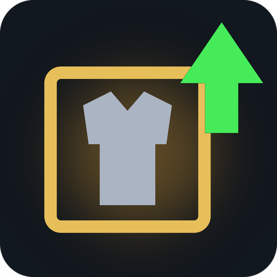
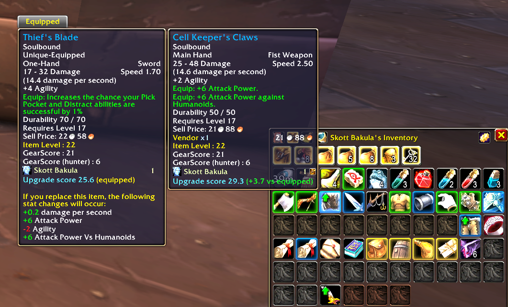
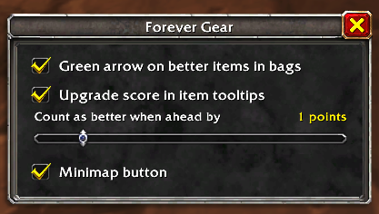

# Forever Gear

For **WoW Forever** (Interface 16001):

- Green arrow on bag items that are better than what you wear (Bagnon and the default bags).
- "Upgrade score" line in every gear tooltip, including the "Equipped" comparison tooltip,
  with the difference to what you wear.

The score weighs stats for your class (rough leveling values), weapon damage per second
and "Equip:" bonuses. Items you can't use (level, armor or weapon skill) never get an arrow.

`/fgear` – settings (also the minimap button and the addons menu).

MIT License.
